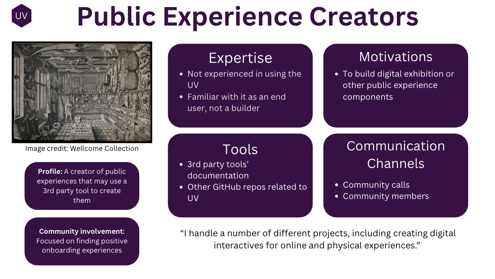
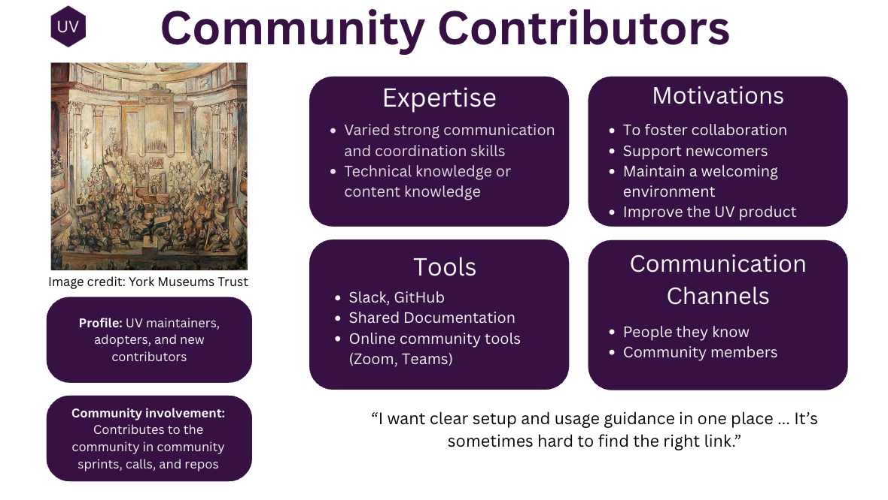
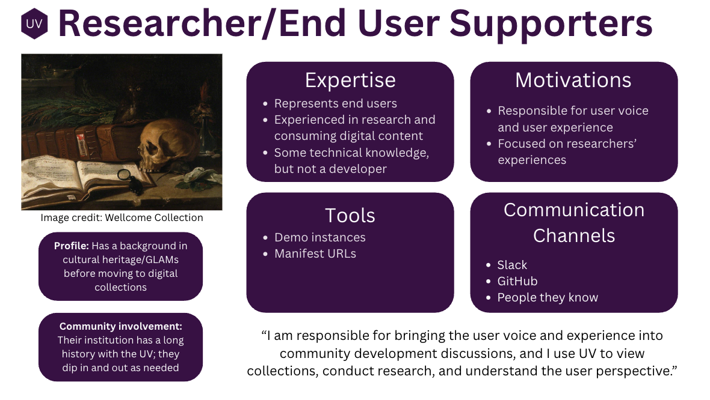
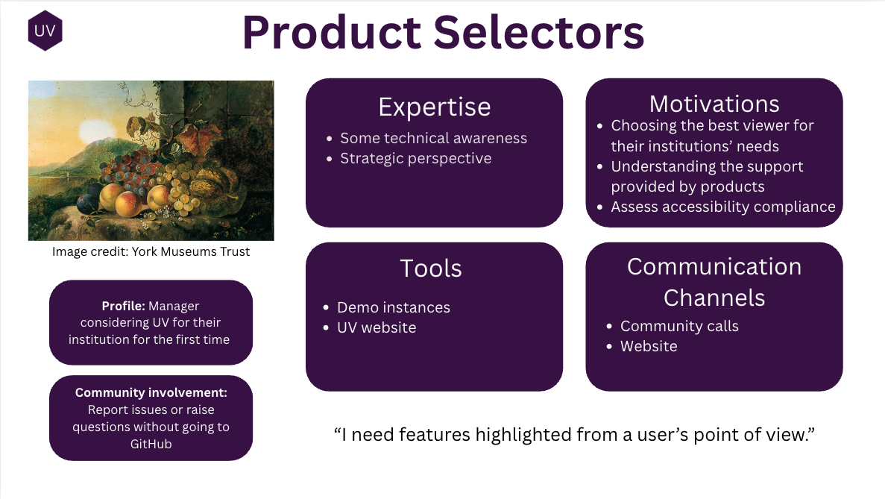
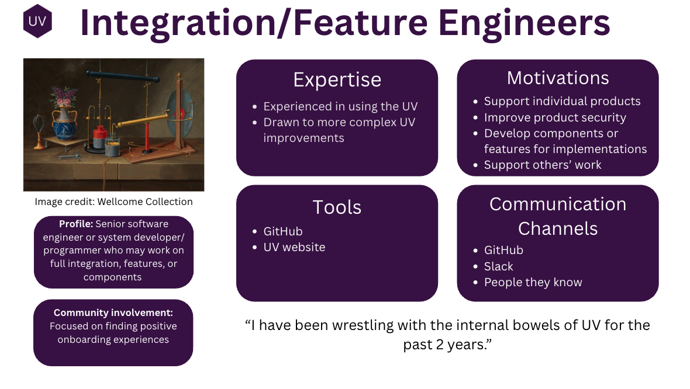

If you’re reading this, you’re likely a user of the Universal Viewer, whether you’ve implemented the latest or an older version on a website or at your institution, or you’re a community member involved in helping shape the viewer and its future. Maybe you would describe yourself as someone with technical experience and perspective, or maybe you’d describe yourself as not technical. You might be a researcher, a developer, an educator, or a manager. You might be more than one of these.

The UV community sprint team recently completed a full sprint in the winter of 2025-2026 to migrate and update the UV website to better support you, our users. Of course, to do that, we needed to better understand what you do and what information you need from the website.

We began with some assumptions about your role relating to the viewer, how experienced you are with it, how familiar you are with the community, and which version you’re using. Through the team’s years of experience developing the Universal Viewer, we had an idea of how to segment you, our audiences, as we began the sprint. Our assumptions gave us an initial direction and a baseline to validate.

Initially, we identified the following audience groups:

- Potential Adopters
- Institutional Implementers
- Legacy Implementers (those working with legacy versions of the UV)
- Beginner Installers
- Experienced Users/Contributors/Committers
- Steering Group Members
- General Users (members of the public, educators, researchers)

We wanted to validate our assumptions, so we conducted discovery interviews with representatives from these groups we created as part of our efforts to ensure the new website aligned with your needs – instead of our assumptions of what you need.

For our user research project, we talked to representatives from these groups:

- Potential Adopters
- Institutional Implementers
- Legacy Implementers
- Beginner Installers
- Experienced Users
- Community Members

Since this was a short sprint that involved many moving parts, we conducted interviews with 1-3 people from these audience groups in January of 2026\. We learned a lot from those who participated (if you did, thank you\!) Some of the most important findings included:

- It’s often difficult to find community event and participation information.
- Non-technical users sometimes found the content on the old website overwhelming and unwelcoming.
- Developers may need more signposting to relevant parts of the code to save time.
- Despite the gaps in original website content, it is still often a first stop for some people beginning their journey with the UV.
- There wasn’t enough information on the old website about examples of how the UV is used and what it can do.

We reflected our findings in the design and architecture choices we made for the migrated and updated website. Some examples:

- We separated the “Demo” page and the “Documentation” page to help users find implementation examples and technical documentation.
- We link to GitHub as the authoritative and up-to-date source of technical documentation.
- We created an Events calendar to highlight upcoming community events, and put it on both the Events and Community pages to make it more findable.

But if you’re one of those people who takes personality quizzes, you might want to know which audience group you fall into. And for that, we have personas.

We initially developed them along the lines of the original audience groups we created, but we realized that wasn’t as accurate as it could be, based on our findings. For instance, many users we assumed would be technical described themselves as decidedly not technical. To make the personas more relevant to you, our real users, we focused on _activities or actions performed_, instead of professional or UV-related _role_.

**Here’s what we came up with:**

We hope you see yourself in one of these personas, and if you don’t – we look forward to hearing from you about your own experiences. We plan to continue to conduct user research to keep our community sprints and the UV working for you.
